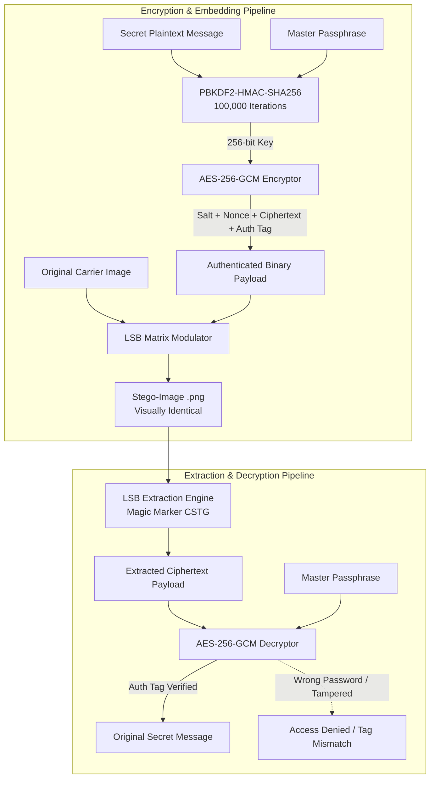

# PixelCrypt: Dual-Layer Image Steganography & Authenticated Cryptosystem

An academic-grade, deterministic cybersecurity platform combining **AES-256-GCM (Galois/Counter Mode) Authenticated Encryption** with **Least Significant Bit (LSB) Lossless Steganography** and quantitative steganalysis metrics (MSE & PSNR).

---

## 📌 Project Abstract

In high-stakes cybersecurity and confidential communication, standard cryptography conceals the *meaning* of data but reveals its *existence*. An eavesdropper or automated surveillance node detecting encrypted ciphertext can intercept the transmission or target the sender. Conversely, pure steganography conceals the *existence* of communication within benign carriers (e.g. digital images) but offers zero protection if the stego-carrier is detected or subjected to extraction attacks.

This project designs and implements **PixelCrypt**, a dual-layer "Defense-in-Depth" security architecture:
1. **Layer 1 (Cryptographic Armor):** Plaintext data is encrypted using military-grade **AES-256-GCM** with keys derived via **PBKDF2-HMAC-SHA256** (100,000 iterations). Galois/Counter Mode provides both confidentiality and a 128-bit authentication tag, guaranteeing tamper-proof integrity and complete resistance to chosen-ciphertext attacks.
2. **Layer 2 (Steganographic Camouflage):** The binary ciphertext stream is embedded into the **Least Significant Bits (LSB)** of 24-bit RGB lossless image matrices (`.png` / `.bmp`).
3. **Fidelity & Steganalysis Suite:** Computes **Mean Squared Error (MSE)**, **Peak Signal-to-Noise Ratio (PSNR)**, and comparative RGB color histograms, proving that steganographic embedding introduces imperceptible distortion (PSNR > 65 dB).

---

## 🏗️ System Architecture



---

## 🔬 Mathematical Formulations

### 1. LSB Pixel Modulation
For an 8-bit color channel $C \in [0, 255]$ and a secret data bit $b \in \{0, 1\}$:
$$C' = (C \ \& \ \text{0xFE}) \ | \ b$$
The maximum modification is $|C' - C| \le 1$, ensuring alterations remain beneath the human visual threshold.

### 2. Mean Squared Error (MSE)
Quantifies average squared difference between original carrier $I$ and stego-image $K$ of dimensions $M \times N$:
$$\text{MSE} = \frac{1}{3MN} \sum_{i=0}^{M-1} \sum_{j=0}^{N-1} \sum_{c \in \{R,G,B\}} [I(i,j,c) - K(i,j,c)]^2$$

### 3. Peak Signal-to-Noise Ratio (PSNR)
Evaluates visual fidelity in decibels (dB):
$$\text{PSNR} = 10 \cdot \log_{10} \left( \frac{255^2}{\text{MSE}} \right)$$
* $\text{PSNR} > 30 \text{ dB}$: Acceptable fidelity.
* $\text{PSNR} > 50 \text{ dB}$: Completely imperceptible to human eyes.
* **PixelCrypt Benchmark:** $\mathbf{65 \text{ to } 85 \text{ dB}}$ (Virtually zero visual distortion).

---

## 📁 Project Directory Structure

```
PixelCrypt/
├── src/
│   ├── __init__.py
│   ├── crypto_engine.py      # AES-256-GCM + PBKDF2-HMAC-SHA256
│   ├── stego_engine.py       # LSB Modulation, capacity calculation, magic marker
│   └── steganalysis.py       # MSE, PSNR, 50x Difference Map, RGB Histograms
├── static/
│   ├── css/
│   │   └── style.css         # Modern vibrant academic theme
│   ├── sample_images/        # Included 1-click test images (nature, cyber)
│   └── uploads/              # Generated stego images and analysis plots
├── templates/
│   └── index.html            # User-friendly interactive web interface
├── app.py                    # Flask server and API endpoints
├── test_vault.py             # Automated unit tests (6/6 passing)
├── run_vault.bat             # 1-Click Windows desktop launcher
├── requirements.txt          # Python dependencies
└── README.md                 # Full academic project documentation
```

---

## 🚀 How to Run (1-Click)

1. Navigate to:
   `D:\Academics\BCA Third Year (2026-27)\5th Sem\5th_Sem_Project`
2. Double-click:
   **`run_vault.bat`**
3. Your browser will automatically open:
   **`http://127.0.0.1:5000`**

---

## 🎓 Top Viva Questions & Answers

**Q1: Why use AES-256-GCM instead of AES-CBC?**  
*Answer:* Standard AES-CBC only provides confidentiality and is vulnerable to padding oracle attacks unless paired with a manual HMAC. AES-GCM is an Authenticated Encryption with Associated Data (AEAD) mode that produces an authentication tag alongside ciphertext, verifying that the hidden data has not been modified or corrupted.

**Q2: Why is PNG required instead of JPEG?**  
*Answer:* JPEG uses lossy compression (Discrete Cosine Transform and quantization tables) which discards high-frequency pixel details, corrupting LSB bits upon saving. PNG uses lossless compression (DEFLATE algorithm), guaranteeing 100% bit-exact pixel preservation.

**Q3: How much data can an image hold?**  
*Answer:* Each pixel has 3 color channels (R, G, B), providing 3 bits per pixel. An $800 \times 600$ image has 480,000 pixels = 1.44 million bits = **180,000 bytes (~175 KB)** of hidden storage.
